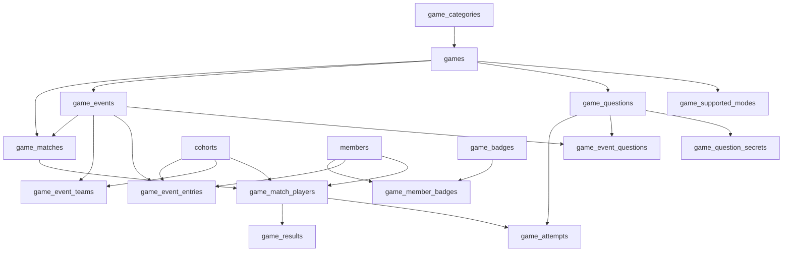

# PlayMate GameZone DB 확장 — 033

**대상:** PostgreSQL 18, PlayMate 기존 `members`, `institutions`, `programs`, `cohorts`, `member_enrollments` 구조.

**범위:** Python·SQL·Frontend·CS·AI 퀴즈, 일일 퀴즈, 코딩 문제, 버그 헌트, 타자 대결(개인/1:1/기수 대항), 반응속도·카드 기억력·아케이드 미니게임, 주간 기수 대항전, 랭킹, 배지.

**제외:** 공부방, 학습 타이머, 관리자 가입 승인, 수강 종료 시 접근 만료.

## 추가 구조

| 테이블 | 역할 | 주요 관계 |
|---|---|---|
| `game_categories` | 6개 게임 분야 | `games` 및 `game_questions`에 연결 |
| `games` | 게임 종류·규칙·노출 상태 | 게임 콘텐츠 최상위 |
| `game_supported_modes` | 개인/1:1/팀 지원 방식 | `(game_id, game_mode)` 복합키 |
| `game_questions` | 퀴즈·코딩·타자 문제 공개 데이터 | `games` 참조 |
| `game_question_secrets` | 정답·비공개 채점 규칙 | `game_questions`와 1:1 |
| `game_events` | 일일 퀴즈·주간 기수 대항전 | 일정·상태·게임(선택) |
| `game_event_questions` | 이벤트에 출제할 문제 | 이벤트+문제 매핑 |
| `game_event_entries` | 이벤트 공식 참가·중복 신청 방지 | `(event_id,member_id)` 고유 |
| `game_event_teams` | 기수별 대항전 팀 | 이벤트당 기수 1팀 |
| `game_matches` | 개인전·대결·팀 경기 세션 | 게임, 이벤트, 호스트 |
| `game_match_players` | 참가자 및 경기 당시 기수 소속 | 경기+회원 유일 |
| `game_attempts` | 답안 제출·문제별 수행 내역 | 클라이언트 `request_id` 중복 방지 |
| `game_results` | 경기별 확정 점수/소요 시간/WPM | 경기+회원 유일 |
| `game_badges` | 배지 종류·조건 | 기존 레벨 체계와 별도 |
| `game_member_badges` | 회원의 배지 획득 이력 | 회원당 같은 배지 1회 |

**뷰 3개:** `v_game_member_rankings`(전국/교육기관/기수 필터링), `v_game_weekly_cohort_scores`(주간 기수 합계), `v_game_daily_quiz_scores`(일일 퀴즈 최고 기록).

## ERD 관계 요약



## 안전한 적용 절차 (DBeaver)

1. `031`·`032` 적용 여부와 기존 DB 백업을 확인합니다. `033`은 기존 테이블을 변경하지 않습니다.
2. `database/sql/033_gamezone_schema.sql` 전체를 **복사한 별도 편집창**에서 `COMMIT;`을 `ROLLBACK;`으로 바꾸어 **전체 스크립트를 한 트랜잭션으로** 실행합니다. 오류가 없는지 확인합니다.
3. 원본 `033_gamezone_schema.sql`을 `COMMIT;`까지 전체 실행합니다.
4. `database/sql/033_gamezone_verify.sql`을 실행합니다. 15개 테이블, 3개 뷰, 카테고리 6개, 게임 12개가 조회되어야 합니다.
5. 게임은 기본 `DRAFT`로 생성됩니다. 퀴즈 정답/채점 엔진/게임 API 구현 이전에 사용자에게 열지 않습니다.

**유의:** DB 스키마와 기본 게임 카탈로그만 추가합니다. 실제 게임 API, 실시간 대전(WebSocket), 일일 콘텐츠 등록, 채점, 보안 샌드박스, XP 지급은 아직 구현되지 않습니다.

## 개발 시 반드시 지켜야 할 정책

- 신규 회원 소속은 `member_enrollments.enrollment_status IN ('ACTIVE','COMPLETED')`로 확인합니다. `expires_at`으로 수료생을 차단하지 않습니다.
- 사용자가 직접 선택한 소속은 **검증된 재학 증명**이 아닙니다. 운영자 권한, 경품, 금전적 보상에 절대 연결하지 않습니다.
- `game_question_secrets`의 정답·비공개 테스트 케이스는 프론트 API에 직렬화하지 않습니다. 퀴즈/코딩 채점은 서버에서 처리합니다. 사용자 제출 코드를 FastAPI 프로세스에서 직접 `exec()`/`eval()` 하지 않습니다.
- `game_attempts`/`game_results`의 점수·정답·소요시간은 **서버에서 확정**합니다. 클라이언트가 보낸 값을 무검증 저장하지 않습니다.
- `game_event_entries`의 복합키는 한 이벤트당 등록 1회만 보장합니다. '일일 퀴즈 1회만 점수 인정'은 서비스에서 공식 경기/최종 결과까지 원자적으로 검사해야 합니다.
- 팀 참가 시 `game_match_players.event_team_id`가 `game_matches.event_id`와 같은 대항전에 속하는지, `cohort_id`도 같은지 서버 트랜잭션에서 검증합니다.
- `game_results`는 확정 결과만 기록하며, 기존 `member_xp_history`를 사용해 `event_key` 중복 지급을 막습니다. `xp_award_policies`의 게임 활동 정책과 실제 지급 로직은 별도 구현해야 합니다.
- XP 무한 파밍 방지를 위해 일일/게임별 지급 횟수와 승리 조작 방지를 설계해야 합니다. 통합 랭킹은 게임별 **최고 점수** 중심, 주간 기수 점수는 이벤트별 합산으로 운영하는 것을 권장합니다.
- 기존 학생 `members.course/cohort`, 모집 게임(`recruit_game_details`), 기존 XP·스킬 테이블은 변경하지 않습니다.

## 랭킹 조회 예제

전국 게임별 최고 점수 순위:

```sql
SELECT member_id, game_id, best_score, games_played
FROM public.v_game_member_rankings
ORDER BY best_score DESC, games_played DESC
LIMIT 20;
```

특정 기관 랭킹(기관 ID 파라미터 사용):

```sql
SELECT member_id, game_id, best_score
FROM public.v_game_member_rankings
WHERE institution_id = :institution_id
ORDER BY best_score DESC LIMIT 20;
```

기수 랭킹(기수 ID 파라미터 사용):

```sql
SELECT member_id, game_id, best_score
FROM public.v_game_member_rankings
WHERE cohort_id = :cohort_id
ORDER BY best_score DESC LIMIT 20;
```

주간 기수 대항전 점수:

```sql
SELECT event_id, cohort_id, participants, completed_games, total_score
FROM public.v_game_weekly_cohort_scores
WHERE event_id = :event_id
ORDER BY total_score DESC, participants DESC;
```

*위 `:institution_id` 등은 Python SQL 클라이언트에서 바인딩할 예시입니다. DBeaver에서는 실제 숫자로 대체해야 합니다.*

일일 퀴즈 기록:

```sql
SELECT event_id, member_id, best_score, fastest_ms
FROM public.v_game_daily_quiz_scores
WHERE event_date = CURRENT_DATE
ORDER BY best_score DESC, fastest_ms ASC;
```

*`CURRENT_DATE`는 DB 세션 시간대에 따라 달라집니다. 운영에서는 한국 날짜를 명시해서 조회하는 편이 안전합니다.*

## Git 커밋 (검증 후)

```powershell
git add database/sql/033_gamezone_schema.sql database/sql/033_gamezone_verify.sql README_GAMEZONE_DB.md
git diff --cached --check
git commit -m "feat(db): add gamezone schema for quizzes matches leagues and rankings"
```
