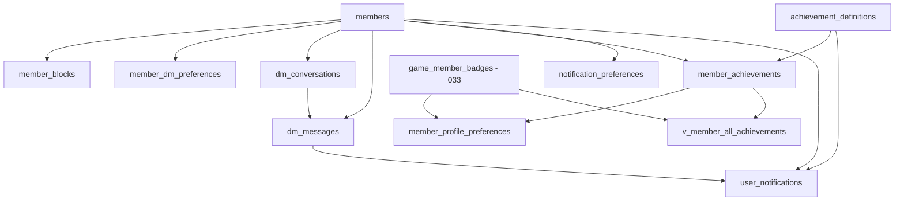

# PlayMate 회원 차단·DM·마이페이지 업적·웹 알림 DB — 034/035

**대상:** PostgreSQL 18 / PlayMate. **설계만 완료**합니다. FastAPI 서비스·프론트 UI·실시간 DM 구현은 추후 작업입니다.

## 요구사항 확정

- **회원 신고 기능 없음.** `member_reports`, `user_reports` 등을 생성하지 않습니다.
- **회원 차단만 제공:** 단방향 차단, 중복 차단 금지, 자기 자신 차단 금지. A 또는 B 어느 한 쪽이 차단했으면 신규 DM을 금지합니다.
- 기존 **게시글 신고 `post_reports`는 그대로 유지**합니다.
- **웹 내부 DM**과 Discord Bot의 **알림 발송용 `notifications`**는 별개입니다.
- 마이페이지는 커뮤니티 업적, 기존 033번 GameZone 배지, 대표 배지를 통합 표시합니다.
- 수료 회원도 `members.member_status='ACTIVE'`라면 이용 가능합니다. 교육과정의 수강 종료일을 DM/배지 조건으로 사용하지 않습니다.
- 공부방 및 학습 타이머 테이블은 포함하지 않습니다.

## 추가되는 테이블 — 정확히 9개

| 파일 | 테이블 | 역할 |
|---|---|---|
| 034 | `member_blocks` | 차단자·대상자 복합 PK, 자기 차단 금지 |
| 034 | `member_dm_preferences` | 서비스 내부 DM 수신 설정, 기본 허용 |
| 034 | `dm_conversations` | 1:1 대화방과 두 회원의 읽음·보관·음소거 상태 |
| 034 | `dm_messages` | 실제 메시지, UUID 중복 요청 방지, 삭제 시 본문 제거 |
| 035 | `achievement_definitions` | 커뮤니티·스킬·소셜·이벤트 업적 종류 |
| 035 | `member_achievements` | 회원의 업적 획득 이력·중복 지급 방지 |
| 035 | `member_profile_preferences` | 직접 획득한 업적/게임 배지 중 대표 1개 선택 |
| 035 | `notification_preferences` | 웹 알림 유형별 수신 동의. `SYSTEM`은 끌 수 없음 |
| 035 | `user_notifications` | 웹 알림함, 읽음·숨김, 이벤트 중복 방지 |

**추가 뷰 1개:** `v_member_all_achievements`는 033의 `game_member_badges`와 신규 `member_achievements`를 `UNION ALL`로 통합합니다. 033의 기존 배지 테이블과 XP·레벨 테이블은 수정하지 않습니다.

## ERD 간략 구조



## 적용 전제

1. 033번 GameZone 스키마가 적용되어 `public.game_badges`와 `public.game_member_badges`가 존재해야 합니다.
2. 034를 먼저 적용한 뒤 035를 적용합니다. 035의 `user_notifications.dm_message_id`가 034의 `dm_messages`를 참조합니다.
3. 기존 `public.members`, `public.posts`, `public.comments`가 존재해야 합니다.
4. **공유 DB 백업**을 확인하고 DBeaver의 대상 데이터베이스 및 schema가 `public`인지 확인합니다.
5. `CREATE TABLE IF NOT EXISTS`는 동명의 *기존 테이블 스키마가 일치하는지* 확인하지 않습니다. 처음 적용된 환경에서만 그대로 실행하세요.

## DBeaver 검증 순서

1. `database/sql/034_member_blocks_direct_messages.sql`의 복사본을 열어 마지막 `COMMIT;`을 `ROLLBACK;`으로 바꾸고 전체 스크립트 실행. 오류가 없으면 원본으로 다시 전체 실행하여 적용합니다.
2. `database/sql/035_member_achievements_notifications.sql`도 같은 방식으로 검증한 뒤 원본 적용합니다.
3. `database/sql/034_035_social_verify.sql`을 전체 실행합니다. `actual_tables=9`, `actual_views=1`, `actual_dm_triggers=5`, 기존 `post_reports`·`notifications`·`game_member_badges` 존속 여부 모두 `true`를 확인합니다.
4. Python 정적 검증: `python -m pytest backend/tests/test_social_schema_034_035.py -q`.

SQL **실제 PostgreSQL 트랜잭션 테스트는 이 패키지 생성 환경에서 실행하지 못했습니다**. DBeaver ROLLBACK 테스트 후 적용해야 합니다.

## 보안·구현 시 필수 조건

- 클라이언트가 `sender_member_id`, `blocker_member_id`, `receiver_member_id`를 임의 지정하도록 허용하지 말고 **로그인 세션에서 결정**합니다.
- DM 목록/상세/메시지 조회 시 반드시 `dm_conversations.member_low_id` 또는 `member_high_id`가 현재 사용자와 일치하는지 서버에서 검사합니다. **DB 쓰기 트리거는 읽기 권한을 대신하지 않습니다.**
- DM 시작·발송은 단방향 차단을 **양방향으로 검사**합니다. 타 회원에게 DM 보낼 때 수신자가 `member_dm_preferences.allow_direct_messages = FALSE`면 403 등으로 막습니다.
- `member_blocks` 추가 시 차단자의 피드·댓글·알림 숨김 정책은 API에서 함께 구현해야 합니다. 기존 게시글 신고 기능은 유지됩니다.
- `dm_messages.body`는 길이 1~4,000자를 강제하며, 삭제 시 `body=''`와 `deleted_at`을 **같은 UPDATE**로 설정합니다. 실제 탈퇴 시 DM 본문 비식별화/보관 기간 처리는 별도 구현해야 합니다.
- `client_message_id`는 UUID4로 생성합니다. 같은 사용자와 UUID를 재사용한 요청은 중복 삽입되지 않습니다. 메시지 조회 페이지는 keyset(`message_id < ...`) 기준으로 구현합니다.
- `notification_preferences`에 행이 없으면 기본 수신 허용으로 간주합니다. `SYSTEM`은 꺼지지 않습니다. **외부 Discord 알림 수신 여부는 기존 `members.external_dm_opt_in`**을 사용해야 합니다.
- `user_notifications`에는 DM 본문을 복사하지 말고 일반적인 신규 메시지 문구만 저장합니다. 알림 생성 시 차단/수신 동의/회원 상태를 서버에서 확인하고 `event_key`로 중복을 제거합니다.
- `achievement_definitions.award_rule`은 규칙 데이터일 뿐 자동 지급 로직이 아닙니다. 지급 조건·중복 호출·보상 조작 방지는 서버에서 검증해야 합니다.
- 대표 배지는 복합 외래키로 **본인이 획득한 업적 또는 게임 배지 1개만** 설정 가능합니다.
- 소속 선택은 실제 학생 신원 확인이 아닙니다. 회원 등급이나 운영자 권한은 별도 검사합니다.

## 단계 구분

- **이번 단계:** DB 마이그레이션·ERD 관계 확정·정적 테스트.
- **다음 개발:** 회원 차단 API, 내부 DM API/실시간 처리, 웹 알림 이벤트 작성, 업적 자동 지급, 마이페이지 UI. 즉, 지금은 서비스 기능이 구현된 상태가 아닙니다.

## Git 기록

```powershell
python -m pytest backend/tests/test_social_schema_034_035.py -q
git status --short
git add database/sql/034_member_blocks_direct_messages.sql database/sql/035_member_achievements_notifications.sql database/sql/034_035_social_verify.sql backend/tests/test_social_schema_034_035.py README_SOCIAL_DB.md
git diff --cached --check
git commit -m "feat(db): add member blocks direct messages achievements and inbox"
```
