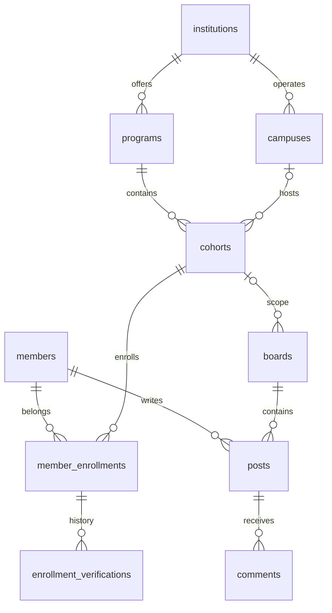
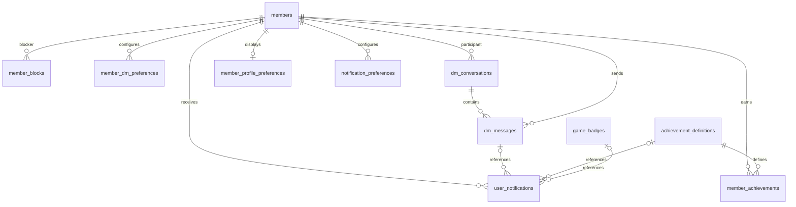
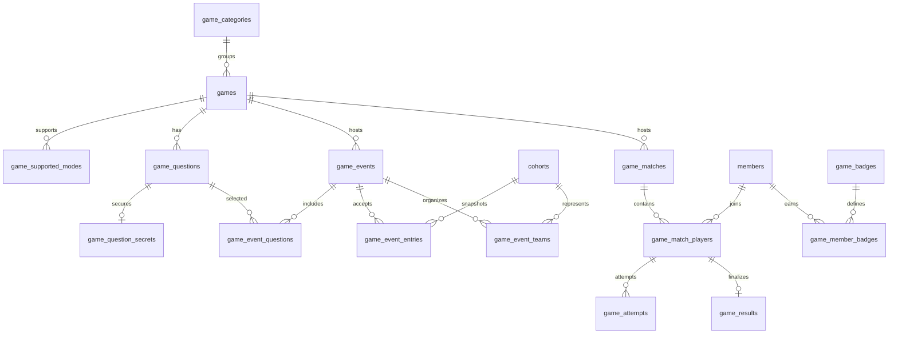

# PlayMate ERD — 035 적용 이후

> 이 문서는 028~035 마이그레이션에서 도입한 핵심 테이블의 **논리적 관계 요약**입니다. 전체 실물 DB의 최신 ERD는 DBeaver에서 `public` 스키마를 열어 내보내야 합니다. 이 요약은 실제 DB 카탈로그를 읽어 생성한 ERD가 아닙니다.

## 1. 교육기관·회원·게시판

## 2. 차단·1:1 DM·업적·알림

참고: `dm_conversations.member_low_id`와 `member_high_id`가 각각 `members`를 참조하는 **두 개의 FK**입니다. 실물 ERD에서는 두 관계를 구분해야 합니다.

기존 `notifications`는 Discord Bot 발송 큐이며 `user_notifications`와 별개입니다. 회원 신고 테이블은 신규 도입하지 않았습니다(기존 `post_reports` 유지).

## 3. GameZone (2차 개발 예정)

## 실물 최신 ERD를 DBeaver에서 추출

1. DBeaver에서 실제 PlayMate `defaultdb` 연결을 엽니다.
2. `Schemas → public` 또는 `Tables`를 더블클릭하고 **Diagram** 탭으로 이동합니다.
3. 너무 많은 테이블이 겹치면 **Auto-arrange layout** 기능을 사용하거나 `File → New → DBeaver → ER Diagram`에서 도메인별 다이어그램을 분리합니다.
4. **Save diagram as…**로 `PNG` 또는 `GraphML`로 내보냅니다. `.png`로 내보낸 파일은 ERD 최신 스냅샷으로 Git에 포함할 수 있습니다.
5. ERD의 관계선은 실제 DB에 선언된 FK만 표시됩니다. 논리적 관계인데 FK가 없다면 이 문서의 Mermaid와 다를 수 있으므로 무결성 점검 결과를 참고합니다.

DBeaver 공식 문서: https://dbeaver.com/docs/dbeaver/ER-Diagrams/

## 완료 기준

- `database/audit/playmate_db_integrity_check.sql`에서 누락 테이블 0, 누락 뷰 0
- NOT VALID FK/CHECK 제약 0건, 무효 인덱스 0건
- 회원 차단·DM 이상 데이터 집계 0건
- FK 선행 인덱스가 없는 항목은 규모/쿼리 기준으로 수동 검토
- DBeaver 최신 ERD PNG 저장 및 확인
- 깃 추적 상태 확인 후 커밋
