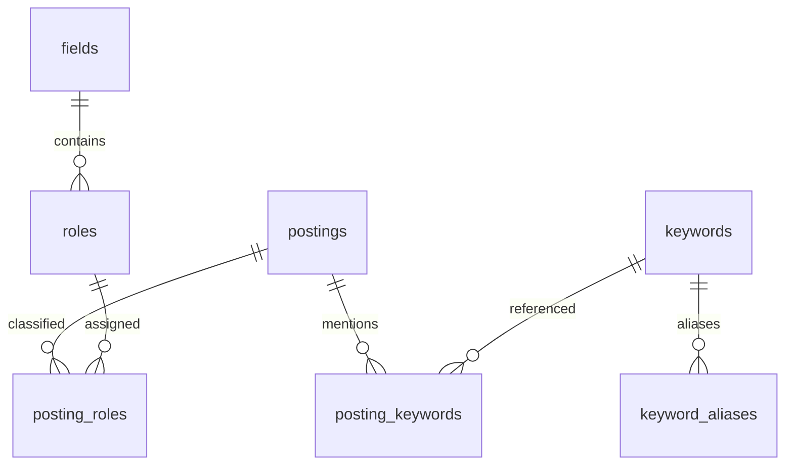

# Issue #31 — 2026-10-25 Phase 1

후속 PostgreSQL 통합 검증을 완료했다. Docker의 새 전용 DB에 467건을 실제 적재했고
재적재·제약조건·롤백을 확인했다. 최신 실행 근거와 기존 테스트 실패 구분은
[통합 검증 보고서](job_trends_phase1_report.md)를 참조한다.

## 기존 구조와 적용 범위

작업 기준은 `feature/31-job-trends-backend`, 원격은 `Six-Over-Sleep/playmate`이다.
시작 시 변경사항은 없었으며 `git ls-remote origin refs/heads/develop`로 확인한
최신 develop `15d7795b68247e2837f643216b08825c4bb3c38c`가 HEAD와 일치했다.
저장소 안에서 AGENTS.md는 발견되지 않았다.

앱 진입점은 `backend/app/main.py`이다. router → service → repository 구분을 사용하며
게시판 repository는 바인딩한 SQL과 cursor를, service는 트랜잭션을 관리한다.
`core/db_connect.py`의 psycopg2 풀과 `db_cursor(commit=True)`를 그대로 재사용한다.
인증에는 psycopg, 모임에는 SQLAlchemy 연결도 존재하므로 새 연결 모듈을 만들지 않았다.
설정은 기존 `.env`와 DB_* 환경변수, 패키지는 uv/pyproject.toml 및 backend requirements를 사용한다.
마이그레이션은 Alembic 없이 `database/sql` SQL과 `database/scripts` 실행 코드로 관리된다.
테스트는 backend/tests pytest 및 선택적 PostgreSQL integration 구조를 따른다.
snake_case, 네 칸 들여쓰기, 한국어 docstring, 대문자 SQL과 파라미터 바인딩을 적용했다.
기존 공통 파일, 게시판·인증·모임·프론트엔드는 수정하지 않았다. 새 router 등록도 없다.

## 사람인 공식 문서 확인

2026-10-25 확인:

- [공식 검색 API](https://oapi.saramin.co.kr/guide/job-search)
- [공식 IT 직무 코드](https://oapi.saramin.co.kr/guide/code-table5?mcode=2)
- [공식 사용안내](https://oapi.saramin.co.kr/guide/info)

GET /job-search, Accept: application/json, access-key 요청 변수를 사용한다.
실제 API 호출은 수행하지 않았다. 정상 JSON은 jobs.count/start/total/job 배열이며
예제의 count/start는 숫자, total 및 ID/timestamp는 문자열이다.
company.detail.name, position 안의 code/name 객체, 숫자 experience-level.code와
최상위 keyword 및 salary.code/name 구조를 따른다. 코드표의 상위 IT 코드는 2이다.
문서의 오래된 JSON 예제 코드와 최신 코드표가 다르므로 생성기는 확인한 현재 코드만 사용한다.

명시적 선택 출력은 posting-date, expiration-date, industry-keyword-code,
job-code-keyword-code, read-cnt, apply-cnt이며 요청 fields에 의존한다.
나머지 기본 출력도 현실적인 결측에 대비하여 ID 외에는 NULL을 허용한다.
테스트에서 기본 출력 필드 누락을 주입하는 것은 공식 선택 필드라고 주장하는 것이 아니다.
에러 JSON 예제는 최상위 code/message이다. result 래퍼도 정상 배열과 구분하여 거부한다.
자격요건/우대사항 전문은 문서에 없으며 원본 JSON에 추가하지 않는다.
승인 후 실제 응답과 오류, 필드 누락 및 과거 공고 조회 범위를 재확인해야 한다.

## ERD



모든 테이블은 job_insights 스키마에 생성한다. public 테이블은 참조하거나 변경하지 않는다.
DDL의 IF NOT EXISTS는 같은 마이그레이션 재실행을 위한 것이며 기존의 다른 테이블 정의를
자동 업그레이드하거나 스키마 드리프트를 검증하는 도구는 아니다.

## 테이블·컬럼 명세

| 테이블 | 컬럼/타입 | 제약·용도 |
|---|---|---|
| fields | field_id bigint identity, field_code text, field_name text | PK, code UNIQUE, 모두 필수 |
| roles | role_id bigint identity, field_id bigint, role_code text, role_name text | PK, fields FK, code UNIQUE, 모두 필수 |
| postings | posting_id bigint identity | 내부 PK |
| postings | source text, source_job_id text | 필수, source mock/saramin CHECK, 두 컬럼 UNIQUE, ID 공백 금지 |
| postings | source_url text, is_active boolean | 원본 URL/진행 상태, 결측 NULL |
| postings | posted_at, modified_at, expires_at timestamptz | Unix 초 → UTC aware datetime, 비양수 날짜 NULL, 원본 raw 유지 |
| postings | company_name, title text | company.detail.name / position.title |
| postings | location_code, location_name, job_type_code text | 원본 지역/고용형태, 복수 코드 문자열 보존 |
| postings | industry_code, industry_name, job_mid_code, job_code text | 원본 업종/직무, 내부 role_code와 별개 |
| postings | experience_code, education_code text | 코드 문자열화, 원본 숫자 타입은 raw 보존 |
| postings | keyword_text, salary_code, salary_name text | 원본 키워드/급여, 누락 NULL |
| postings | salary_min_manwon, salary_max_manwon integer | 내부 파생값, Phase 1 전부 NULL, 최소 비음수/최대≥최소 CHECK |
| postings | raw_payload jsonb | 개별 원본 job 객체, 필수/객체 CHECK |
| postings | collected_at timestamptz | 적재·재적재 시각, 필수/현재 시각 기본값 |
| posting_roles | posting_id bigint, role_id bigint, is_primary boolean | 복합 PK, 양쪽 FK, 대표 직무 공고당 최대 1개 partial UNIQUE |
| posting_roles | assignment_source text | 추가 내부 관리 필드. manual/title CHECK, 기본 manual. 자동 분류 갱신 시 수동 분류 보존 목적 |
| keywords | keyword_id bigint identity, keyword_code/name/type text | PK, code UNIQUE, type skill/certification CHECK, 필수 |
| keyword_aliases | alias_id bigint identity, keyword_id bigint, alias_text text | PK, keywords FK, (keyword_id, alias_text) UNIQUE, 빈 별칭 금지 |
| posting_keywords | posting_id bigint, keyword_id bigint, mention_source text | 삼중 PK, 양쪽 FK, api_keyword/title/requirement/preference CHECK |

명세에서 필수라고 명시하지 않은 원본 posting 컬럼은 NULL 허용이다.
관계 테이블의 공고 FK는 ON DELETE CASCADE이며 나머지는 기본 NO ACTION이다.
인덱스: UNIQUE/PK 자동 인덱스, roles.field_id, postings(source,posted_at),
posting_roles.role_id, posting_keywords.keyword_id 및 대표 직무 partial UNIQUE.
원본 JSON 전체 검색이나 대규모 본문 검색이 없어 JSONB GIN은 추가하지 않았다.

## 적재·분류 정책

목업/실제 응답 → parse_response → normalize_job → save_postings → PostgreSQL로 연결된다.
source는 호출자가 전달하며 원본 JSON에는 PlayMate 메타데이터를 넣지 않는다.
반복 실행은 (source,source_job_id) UPSERT로 현재 스냅샷을 갱신한다.
동일 배치 안 중복은 마지막 객체를 사용한다. 잘못된 개별 공고는 failed로 집계하고 나머지는 적재한다.
잘못된 응답 컨테이너/API 오류는 DB에 연결하기 전에 예외로 거부한다.
한 입력 배치를 하나의 기존 db_cursor 트랜잭션으로 처리한다. DB 오류는 롤백 후
JobTrendsLoadError.report로 보고하며 커밋 응답 유실은 원래 예외 원인에 남는다.
커밋 결과 불명 상태에서는 실패 보고가 실제 미저장을 보장하지 않으므로 같은 입력으로 재시도한다.

LoadReport.success는 커밋한 고유 공고 수(신규+갱신), duplicate는 입력 내 중복+
이미 존재해 갱신한 공고 수, skipped는 입력 내 중복 객체 수, failed는 잘못된 객체+
DB 실패 시 적재 후보 수다. 중복은 success와 겹칠 수 있어 네 숫자를 단순 합산하지 않는다.
통계는 source를 반드시 하나로 제한한다. 현재 스냅샷 모델이며 수정 이력/과거 상태 복원은 범위 밖이다.

직무는 제목에 명시된 내부 직무명만 보수적으로 매칭한다. 한글 띄어쓰기나 다른 명칭을
전부 인식하는 분류기는 아니다. 일반적인 AI 제목에서 LLM/에이전트를 추측하지 않는다.
미분류와 복수 분류를 허용하고 자동 대표 직무는 지정하지 않는다.
재적재 시 title 기원 비대표 관계만 교체하고 manual 및 대표 관계는 보존한다.
공고·관계는 배치 SQL, 사전/별칭은 배치당 한 번 조회하며 공고당 새 연결을 만들지 않는다.

## 재현 방법

루트에서 Python 3.13+와 기존 프로젝트 의존성 및 pytest를 준비한다.

```powershell
uv sync
uv pip install -r backend/requirements-dev.txt
uv run python database/scripts/generate_job_trends_mock.py --sample --output database/fixtures/job_trends_sample.json
uv run python -m pytest backend/tests/test_job_trends.py -q
uv run python database/scripts/generate_job_trends_mock.py --output database/fixtures/job_trends_full.json
```

시드 기본값은 31이며 --seed로 변경한다. 샘플 5건 검증 후 전체 파일을 생성했다.
전체 파일은 오프라인 통합 fixture다. 실제 API는 페이지 count 최대 110이므로
467건을 서버 한 페이지에서 받을 수 있다는 의미가 아니다. 실제 수집에서는 각 페이지를
같은 load_response에 차례로 전달한다. 페이지 누적 요청과 API 호출기는 이번 범위 밖이다.

새로 생성한 **빈 전용 로컬 PostgreSQL DB**를 준비한 뒤 기존 연결 설정을 명시한다.
기존 .env의 공유 DB를 그대로 사용하지 않는다. 비밀번호는 터미널/로그에 노출하지 않게 설정한다.

```powershell
$env:APP_ENV='test'
$env:DB_HOST='127.0.0.1'
$env:DB_PORT='5432'
$env:DB_NAME='job_insights_test_phase1'
$env:DB_USER='<전용 테스트 사용자>'
# DB_PASSWORD는 안전한 환경변수 주입으로 설정
$env:DB_SSLMODE='disable'
$env:PYTHONPATH="$PWD/backend;$PWD"
$env:RUN_POSTGRES_INTEGRATION='1'
uv run python -m pytest backend/tests/integration/test_postgres_job_trends.py -q
```

통합 테스트는 빈 전용 DB를 요구하며 마이그레이션/시드를 두 번 실행한 뒤
샘플→전체→재적재, 총건수/분기/JSONB/대표 중복/FK를 검사한다. 성공 후 데이터를 보존한다.
통합 테스트를 끝낸 동일 DB를 다시 검사할 때는 새 빈 전용 DB를 사용한다.
수동 실행은 다음과 같으며 통합 테스트와 별개의 빈 전용 DB에서 실행한다.

```powershell
uv run python database/scripts/load_job_trends.py --isolated-local --migrate --input database/fixtures/job_trends_sample.json
uv run python database/scripts/load_job_trends.py --isolated-local --input database/fixtures/job_trends_full.json
uv run python database/scripts/load_job_trends.py --isolated-local --input database/fixtures/job_trends_full.json
```

DB_NAME/host/APP_ENV 가드는 오접속 방지 장치다. 실제 격리 여부는 실행자가 확인해야 한다.
최초 실행에서는 Docker 엔진이 꺼져 DB 검증을 수행하지 못했다.
후속 실행에서는 새 컨테이너 playmate-job-insights-phase1-20261025의
job_insights_test_phase1 DB에 실제 적용하고 검증했다. 접속은 127.0.0.1:49339이다.
마이그레이션/시드 재실행, JSONB/FK/UNIQUE/실제 오류 롤백이 통과했다.
공유 DB에는 접속하지 않았다. 출처 분리 검증용 saramin 레코드는 수정 후 테스트에서 롤백한다.

## 목업 결과 (파일/파서 및 실제 DB 검증)

| 분기 | 생성·정규화 건수 | DB 적재 |
|---|---:|---|
| 2025-Q1 | 51 | 51 |
| 2025-Q2 | 57 | 57 |
| 2025-Q3 | 63 | 63 |
| 2025-Q4 | 64 | 64 |
| 2026-Q1 | 71 | 71 |
| 2026-Q2 | 77 | 77 |
| 2026-Q3 | 84 | 84 |
| 합계 | 467 | 467 |

정규화 결과 NULL: company_name 36, keyword_text 43, salary_code 67,
salary_min_manwon 및 salary_max_manwon 각 467건이다. 급여 구간에서 평균 연봉을 추측하지 않는다.
고유 ID 467개이며 샘플 내 결측과 복수 코드도 확인했다.
실제 DB 재적재 후 공고 467건/직무 관계 561건/키워드 관계 259건이 유지됐다.
이 수치는 전부 가상 시연 데이터이며 실제 채용시장 통계로 사용할 수 없다.
30개 직무 시드는 전부 등록하지만 각 직무별 양수 표본을 보장하는 데이터는 아니다.

## 선아 전달 사항

분야 8개/직무 30개 전체 코드와 이름은 `backend/app/services/job_trends_catalog.py`의
FIELDS/ROLES가 단일 기준이다. 사람인 코드와 내부 코드를 직접 동일시하지 않는다.
keywords는 표준어, keyword_aliases는 별칭, posting_keywords는 공고-표준어-근거 출처다.
Python/Java만 최소 테스트 사전으로 등록했다. 전체 사전과 자격증 사전은 선아 작업 범위다.
별칭은 여러 표준어에 연결 가능하므로 중의적 별칭은 사전 담당자가 검토한다.
keyword_mentions(row, [(keyword_code, alias_text), ...])가 기본 추출 인터페이스이며
중복을 제거한 (keyword_code, mention_source) 쌍을 반환한다. SQL 저장은 repository에서 처리한다.
후속 분석기는 requirement/preference를 사용하려면 실제 원문 근거를 먼저 확보해야 한다.
현재 재적재는 title/api_keyword 관계를 갱신하므로 이 두 출처를 다른 적재기와 동시에 수정하지 않는다.

```sql
SELECT p.source_job_id, p.title, k.keyword_code, pk.mention_source
FROM job_insights.postings AS p
JOIN job_insights.posting_keywords AS pk USING (posting_id)
JOIN job_insights.keywords AS k USING (keyword_id)
WHERE p.source = 'mock';

SELECT to_char(posted_at AT TIME ZONE 'Asia/Seoul', 'YYYY-"Q"Q') AS quarter,
       COUNT(DISTINCT source_job_id) AS postings
FROM job_insights.postings
WHERE source = 'mock'
GROUP BY 1 ORDER BY 1;
```

keyword_text/raw_payload는 원본 증거다. 결측은 0이나 부재를 의미하지 않는다.
직무별 다중 배정 통계의 합은 전체 공고 수를 초과할 수 있다.
API 연결 규격 및 10월 26일 우선순위는 별도 `job_trends_api_contract.md`를 따른다.
