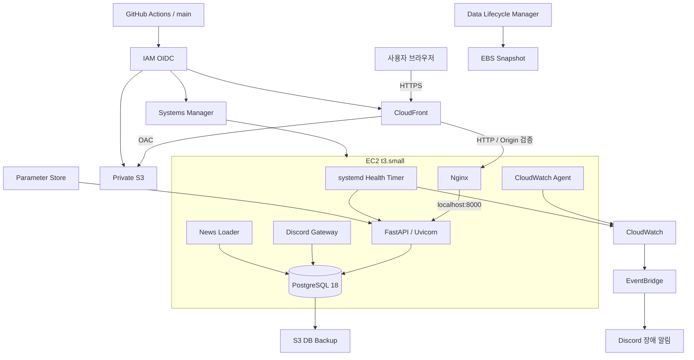

# PLAYMATE AWS 운영 아키텍처

> 기준일: 2026-11-26
> 운영 리전: ap-northeast-2 (서울)

## 1. 구축 목적

PLAYMATE 커뮤니티의 안정적인 서비스 운영을 위해
정적 프론트엔드 배포, 백엔드 API 운영, 자동 배포,
보안, 모니터링 및 장애 복구 체계를 구축한다.

## 2. 전체 아키텍처

## 3. 기술 스택

| 구분 | 기술 | 역할 |
|---|---|---|
| Frontend | React, Vite | 사용자 인터페이스 |
| Backend | FastAPI | REST API |
| Runtime | Python 3.13 | 백엔드 실행 |
| Database | PostgreSQL 18 | 서비스 데이터 |
| OS | Ubuntu 24.04 LTS | 운영체제 |
| Application Server | Uvicorn | ASGI 서버 |
| Reverse Proxy | Nginx | API 프록시 |
| Compute | EC2 | 서비스 실행 |
| Storage | S3, EBS | 정적 파일 및 서버 디스크 |
| CDN | CloudFront | HTTPS 및 콘텐츠 배포 |
| CI/CD | GitHub Actions | 자동 배포 |
| Authentication | IAM OIDC | AWS 임시 인증 |
| Configuration | Parameter Store | 환경변수 관리 |
| Monitoring | CloudWatch | 지표 및 경보 |
| Notification | EventBridge, Discord | 장애 알림 |
| Backup | DLM, S3 Versioning | 백업 및 복구 |

## 4. 운영 리소스

| 항목 | 설정 |
|---|---|
| EC2 Name | playmate-api-prod |
| Instance Type | t3.small |
| vCPU | 2 |
| RAM | 2 GiB |
| Swap | 2 GiB |
| EBS | gp3 20 GiB |
| EBS 암호화 | 활성화 |
| CPU Credit | Unlimited |
| Frontend Bucket | playmate-frontend-prod |
| CloudFront Distribution | E2OLTN93E2NBDU |
| CloudWatch Dashboard | playmate-monitoring |
| Parameter Namespace | /playmate/prod/ |
| DB Pool | 최대 2개 |

## 5. 네트워크 구조

- 사용자는 CloudFront HTTPS 주소로 접속한다.
- S3는 비공개이며 OAC를 통해 CloudFront가 접근한다.
- Nginx는 EC2에서 HTTP 요청을 처리한다.
- FastAPI는 localhost:8000에 바인딩한다.
- PostgreSQL은 EC2 내부에서 운영한다.
- 운영 서버 접속에는 Session Manager를 사용한다.
- 외부 RDS 인스턴스는 운영 구성에서 제외되었다.

## 6. 아키텍처 결정 및 한계

- 베타 규모와 운영 비용을 고려하여 단일 EC2를 유지한다.
- 웹 API, DB, Discord 및 뉴스 작업이 동일 서버의 자원을 공유한다.
- 단일 EC2 장애 시 여러 서비스가 동시에 영향을 받을 수 있다.
- CloudFront와 EC2 Origin 사이에는 아직 HTTPS가 적용되지 않았다.
- 탄력적 IP가 없으므로 EC2 중지 후 시작 시 Origin 주소를 확인해야 한다.
- 고가용성 및 수평 확장은 향후 운영 지표를 기반으로 검토한다.
