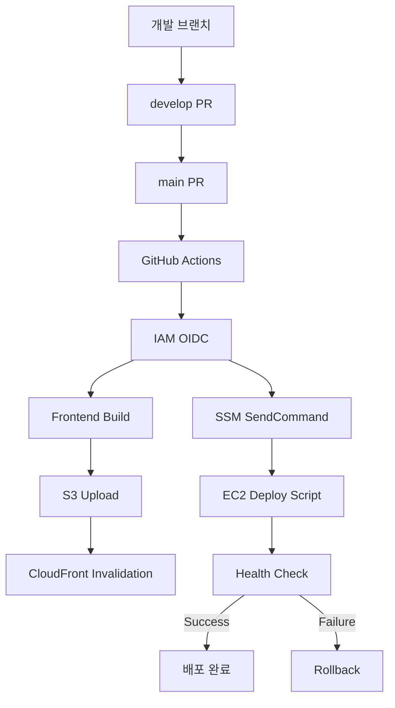

# 운영 배포 가이드

## 1. 브랜치 전략

| 브랜치 | 목적 |
|---|---|
| feature/* | 신규 기능 개발 |
| refactor/* | 구조 개선 |
| docs/* | 문서 작성 |
| develop | 개발 통합 |
| main | 운영 배포 |

운영 배포는 main 브랜치를 기준으로 수행한다.

main 브랜치에는 PR 승인, 변경 후 기존 승인 무효화,
대화 해결 요구 및 강제 Push 방지 설정을 적용하였다.

필수 CI 상태 검사 조건은 추가 검토 대상이다.

## 2. 배포 아키텍처



## 3. 프론트엔드 배포

1. main 브랜치 변경을 감지한다.
2. Node.js 22 환경에서 npm ci를 실행한다.
3. 프론트엔드 빌드를 수행한다.
4. 해시 기반 정적 파일을 S3에 먼저 업로드한다.
5. 일반 공개 파일을 업로드한다.
6. index.html을 마지막에 업로드한다.
7. CloudFront 캐시를 무효화한다.

### 캐시 정책

- 해시 기반 assets: immutable 캐시
- index.html: 캐시 최소화
- API: 캐시 비활성화

이전 정적 파일의 보존을 위해 배포 시
S3 전체 삭제 옵션을 사용하지 않는다.

## 4. 백엔드 배포

| 스크립트 | 역할 |
|---|---|
| playmate-deploy-prod | 전체 배포 및 롤백 |
| playmate-sync-prod | Git SHA 및 의존성 동기화 |
| playmate-parameter-sync | 환경변수 동기화 |
| playmate-restart | 서비스 재시작 |
| playmate-healthcheck | 상태 검사 |

스크립트 설치 경로:

    /usr/local/bin/

운영 소스 경로:

    /opt/playmate

## 5. 백엔드 배포 순서

1. 배포 잠금을 획득한다.
2. 기존 서비스 상태를 검사한다.
3. 기존 Git SHA를 기록한다.
4. 환경변수 파일을 안전하게 백업한다.
5. Parameter Store 설정을 동기화한다.
6. 검증된 main 브랜치의 배포 SHA로 전환한다.
7. uv sync --locked를 통해 의존성을 설치한다.
8. systemd 서비스를 재시작한다.
9. API, DB 및 Schema 상태를 검사한다.
10. 실패 시 이전 코드와 환경변수를 복구한다.

## 6. 배포 확인 명령어

```bash
sudo systemctl status playmate-api --no-pager
/usr/local/bin/playmate-healthcheck
git -C /opt/playmate rev-parse HEAD
```

정상 상태는 다음과 같다.

    PASS: /health
    PASS: /health/db
    PASS: /health/schema
    PLAYMATE_HEALTHCHECK_SUCCESS

## 7. GitHub Actions 변수

| 변수 | 용도 |
|---|---|
| AWS_REGION | 운영 리전 |
| FRONTEND_S3_BUCKET | 운영 S3 버킷 |
| CLOUDFRONT_DISTRIBUTION_ID | CDN 배포 대상 |
| AWS_FRONTEND_ROLE_ARN | 프론트엔드 IAM 역할 |
| AWS_BACKEND_ROLE_ARN | 백엔드 IAM 역할 |
| BACKEND_EC2_INSTANCE_ID | 운영 EC2 대상 |

## 8. 검증 결과 및 제한사항

- 프론트엔드 운영 배포 성공 확인.
- 백엔드 운영 배포 및 헬스체크 성공 확인.
- 배포 스크립트 문법과 파일 권한 확인.
- 실제 실패를 유도하는 자동 롤백 테스트는 미실시.
- 단일 EC2 재시작 중 짧은 서비스 중단이 발생할 수 있다.
- DB 마이그레이션 롤백은 코드 롤백과 별도로 관리한다.
