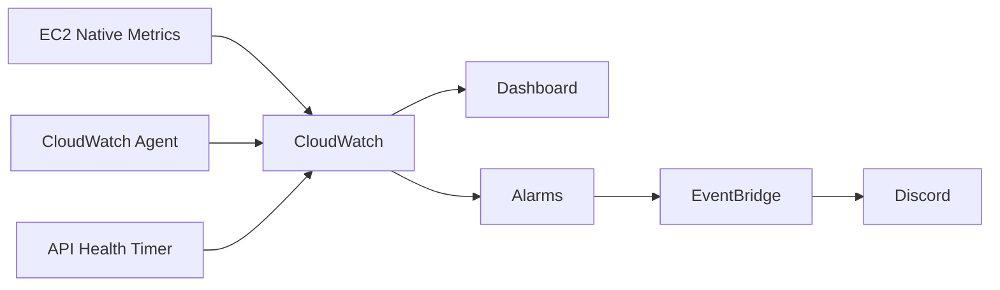

# CloudWatch 모니터링 가이드

## 1. 모니터링 구조



## 2. 운영 대시보드

대시보드 이름:

    playmate-monitoring

### EC2 지표

| 지표 | 설명 |
|---|---|
| CPUUtilization | CPU 사용률 |
| CPUCreditBalance | CPU Credit 잔액 |
| StatusCheckFailed | EC2 상태 검사 |
| NetworkIn | 수신 트래픽 |
| NetworkOut | 송신 트래픽 |
| mem_used_percent | 메모리 사용률 |
| disk_used_percent | 루트 디스크 사용률 |
| swap_used_percent | Swap 사용률 |
| APIHealthStatus | API 종합 상태 |

커스텀 Namespace:

    PlayMate/Production

커스텀 지표 4개를 운영하며 수집 주기는 60초이다.

기존 RDS 위젯 5개는 이력 보존을 위해 유지하였다.
현재 EC2 내부 PostgreSQL의 상태를 나타내는 위젯은 아니다.

## 3. 운영 경보

| 경보 이름 | 조건 |
|---|---|
| playmate-ec2-high-cpu | 기존 CPU 경보 |
| playmate-ec2-status-failed | 기존 EC2 상태 검사 경보 |
| playmate-ec2-high-memory | 80% 이상, 3/5 |
| playmate-ec2-high-disk | 80% 이상, 3/5 |
| playmate-ec2-high-swap | 50% 이상, 3/5 |
| playmate-ec2-low-cpu-credit | 20 미만, 2/3 |
| playmate-ec2-api-unhealthy | 1 미만, 3/3 |

기존 CPU 및 상태 검사 경보의 세부 임계값은
별도 조회가 필요하다.

## 4. API 헬스체크

검사 대상:

- /health
- /health/db
- /health/schema

모두 성공하면 1, 하나라도 실패하면 0을 전송한다.
API 상태 경보는 누락된 데이터도 임계값 위반으로 처리한다.

| 구성 | 이름 |
|---|---|
| Script | playmate-health-metric |
| Service | playmate-health-metric.service |
| Timer | playmate-health-metric.timer |
| 실행 계정 | cwagent |

## 5. 상태 확인

```bash
systemctl status amazon-cloudwatch-agent --no-pager
systemctl status playmate-health-metric.timer --no-pager
systemctl list-timers --all --no-pager
sudo journalctl -u playmate-health-metric.service -n 30 --no-pager
```

정상 로그:

    API_HEALTH_STATUS=1
    METRIC_PUBLISH_SUCCESS

## 6. Discord 장애 알림

| 항목 | 이름 |
|---|---|
| 장애 규칙 | playmate-cloudwatch-discord |
| 복구 규칙 | playmate-cloudwatch-discord-recovery |
| API Destination | playmate-discord-alert |

CloudWatch 경보 상태 변경 이벤트를 EventBridge가 수신하고
API Destination을 통해 Discord로 전달한다.

## 7. 검증 결과

- 커스텀 지표 수집 확인.
- 1분 주기 헬스체크 및 지표 반복 전송 확인.
- 운영 경보 7개 및 대시보드 저장 확인.
- SetAlarmState 기반 Discord 알림 수신 확인.
- 장애와 복구 메시지 각각의 수신 증적은 추가 확인 필요.

## 8. 제한사항

- API 헬스체크는 EC2 내부 기준이다.
- CloudFront 외부 접속 장애를 독립적으로 감지하지 않는다.
- 실제 장애를 유도한 종단 간 검증은 수행하지 않았다.
- 짧은 순간의 부하는 1분 또는 5분 집계에서 완화되어 보일 수 있다.
