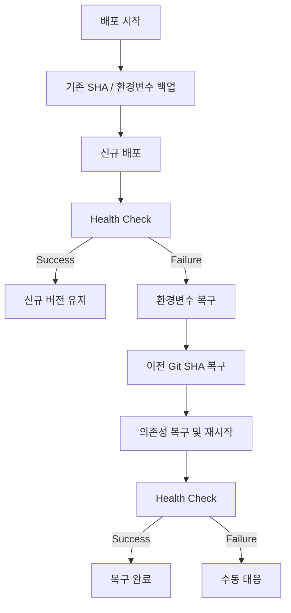

# 백업 및 장애 복구 가이드

## 1. 백업 전략

| 대상 | 방식 | 정책 |
|---|---|---|
| Frontend | S3 Versioning | 이전 버전 보존 |
| Backend | Git SHA | 이전 코드 복구 |
| 환경변수 | Parameter Store 및 로컬 백업 | 배포 전 백업 |
| PostgreSQL | 기존 DB 백업 서비스 | 매일 |
| EBS | DLM Snapshot | 매일, 최근 3개 |

## 2. S3 백업 정책

버킷:

    playmate-frontend-prod

수명 주기 정책:

    playmate-prod-version-cleanup

- 버전 관리 활성화.
- 이전 버전 만료 조건: 30일 및 더 최신 이전 버전 3개 보존.
- 미완료 멀티파트 업로드: 7일 후 정리.
- 현재 운영 객체의 자동 만료 없음.

2026-11-26 기준 index.html 버전 5개를 확인하였다.

직전 버전의 index.html과 직접 참조하는 JS/CSS
파일 2개의 존재 여부를 확인하였다.

## 3. 프론트엔드 복구 절차

1. 장애 원인과 정상 배포 버전을 식별한다.
2. 현재 버전 ID를 기록한다.
3. 이전 index.html을 별도 위치에 다운로드한다.
4. 해당 버전의 정적 파일과 동적 로딩 파일을 검사한다.
5. 현재 백엔드 API와의 호환성을 확인한다.
6. 정상 버전을 현재 객체의 새 버전으로 복원한다.
7. Content-Type 및 Cache-Control을 확인한다.
8. CloudFront 캐시를 무효화한다.
9. 로그인과 주요 화면 동작을 확인한다.

실제 운영 객체 복원은 담당자 승인 후 수행한다.

## 4. 백엔드 자동 롤백



스크립트의 백업, 잠금 및 복구 로직은 확인하였다.
실제 실패 주입 및 자동 복구 테스트는 미실시 상태이다.

## 5. 환경변수 복구

```bash
sudo /usr/local/bin/playmate-parameter-sync --check
```

2026-11-26 검증 결과:

- 파라미터 15/15 조회 성공.
- EnvironmentFile 검증 성공.
- 기존 운영 파일 변경 없음.
- API, DB, Schema 검사 성공.

실제 환경변수 적용 및 재시작은 변경 내용을 확인하고 수행한다.

## 6. EBS 자동 백업

| 항목 | 설정 |
|---|---|
| DLM 정책 | playmate-prod-ebs-backup |
| Policy ID | policy-0937172c07c6ac5f6 |
| 대상 | 운영 EBS 20 GiB |
| 대상 태그 | Backup=playmate-prod |
| 주기 | 24시간 |
| 시작 일정 | 19:00 UTC |
| 한국 시간 | 오전 04:00 |
| 보존 | 최근 자동 스냅샷 3개 |
| 교차 리전 복제 | 미사용 |
| Fast Snapshot Restore | 미사용 |
| 정책 상태 | ENABLED |

기존 수동 스냅샷 1개를 별도로 보존한다.
첫 DLM 자동 스냅샷 생성 및 복구 가능성은 미검증이다.

## 7. DB 백업

기존 playmate-db-backup.timer를 사용한다.

- 실행 일정: 매일 오전 03:00 KST.
- 담당자: DB 백업 담당자.
- EBS 스냅샷은 PostgreSQL 논리 백업을 대체하지 않는다.
- DB 데이터 정합성 및 실제 복구 여부는 담당자와 확인한다.

## 8. 복구 목표

자동 EBS 백업 주기는 24시간이다.
실제 복구 지점 목표(RPO) 및 복구 시간 목표(RTO)는
복구 테스트 이후 확정한다.

## 9. 미검증 사항

- 실제 프론트엔드 롤백.
- 실제 백엔드 배포 실패 복구.
- EC2 재부팅 후 서비스 복구.
- EBS 스냅샷 복원.
- DB 백업 복원 정합성.
- 신규 DLM 정책의 최초 실행.
