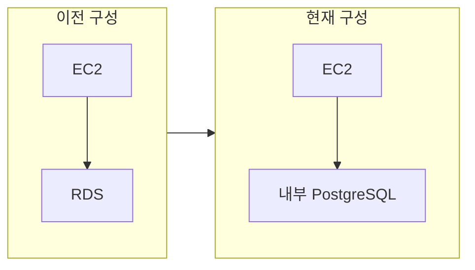

# AWS 운영 비용 분석

> 기준일: 2026-11-26
> 리전: ap-northeast-2
> 통화: USD

## 1. 실제 11월 누적 비용

| 서비스 | 비용 |
|---|---:|
| RDS | 11.02 |
| EC2 | 2.43 |
| VPC | 1.15 |
| Secrets Manager | 0.12 |
| Systems Manager | 0.01 |
| 기타 | 0.00 |
| 세전 합계 | 14.73 |
| 세금 | 1.47 |
| 합계 | 16.20 |

위 금액은 당시 청구서 조회 결과이며
이후 사용량에 따라 변경될 수 있다.

RDS 비용은 이전 운영 기간의 청구 내역이다.
현재 서울 리전의 RDS 데이터베이스 목록은 0개이다.

## 2. 현재 월간 기본 운영비

월 730시간 운영 기준.

| 항목 | 계산 기준 | 예상 비용 |
|---|---|---:|
| EC2 t3.small | 0.026 x 730 | 18.98 |
| EBS gp3 | 0.0912 x 20 | 1.82 |
| Public IPv4 | 0.005 x 730 | 3.65 |
| Secrets Manager | 시크릿 1개 가정 | 0.40 |
| PostgreSQL | EC2 내부 실행 | 0.00 |
| Parameter Store | Standard 기본 저장료 | 0.00 |
| 세전 합계 | | 24.85 |
| 세금 10% 가정 | | 2.49 |
| 기본 월 예상 비용 | | 27.34 |

## 3. 비용 절감 구조

RDS가 월 730시간 실행되고 gp3 20 GiB를
사용한다는 가정에서 월 기본 비용 차이는
세금 포함 약 43.84 USD이다.

이는 실제 절감 청구액이 아니라 비교 추정치이다.

## 4. 추가 변동 비용

다음 항목은 기본 운영비에 포함하지 않았다.

- CloudWatch 지표 및 경보.
- EBS 자동 스냅샷 저장.
- S3 객체 및 이전 버전 저장.
- CloudFront 요금 및 데이터 전송.
- EventBridge API Destination.
- Unlimited CPU 초과 크레딧.
- Secrets Manager API 호출.
- 잔존 RDS 스냅샷 및 백업이 있을 경우 해당 비용.

팀 공용 계정의 무료 사용량과 실제 사용량에 따라 달라진다.

## 5. AWS Budgets

| 항목 | 설정 |
|---|---|
| 이름 | playmate-beta-monthly |
| 월간 예산 | 30 USD |
| 실제 비용 경보 | 85%, 100% |
| 예상 비용 경보 | 100% |
| 이메일 인증 | 2/2 |
| 자동 리소스 중단 | 없음 |
| 사용 가능한 크레딧 | 조회 시점 0 USD |

기존 30 USD 예산은 유지하였다.
변동 비용을 고려한 잠정 운영 예산은 35~40 USD이다.

AWS Budgets 알림은 지출 상한을 강제하지 않는다.

## 6. 비용 최적화 결과

- EC2 t3.small 유지.
- EBS 20 GiB 유지.
- CPU Credit Unlimited 유지.
- 서울 리전 탄력적 IP 할당 0개 확인.
- 불필요한 중복 대시보드 생성 방지.
- RDS를 현재 상시 실행 비용에서 제외.
- S3 이전 버전 정리 정책 유지.
- DLM 스냅샷 최근 3개 보존 정책 적용.

## 7. 향후 비용 점검

실제 월간 비용은 신규 백업 및 모니터링 사용량이
청구서에 반영된 후 다시 산정한다.
